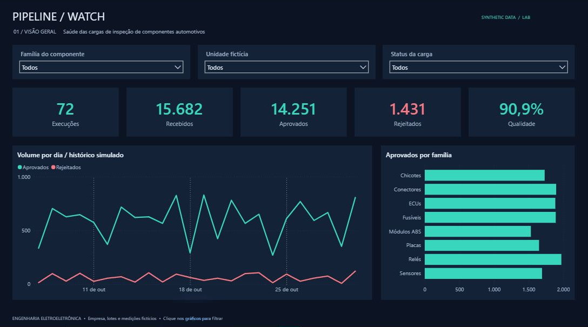
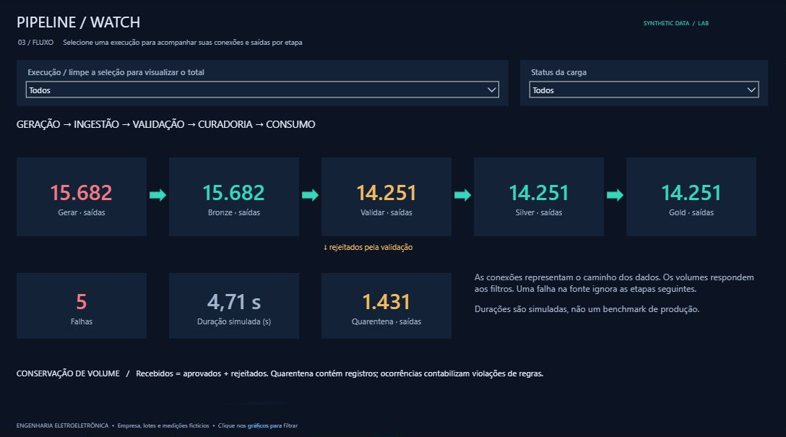
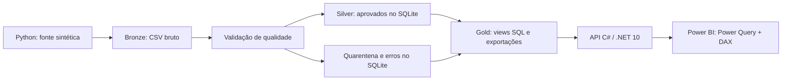

# PipelineWatch

Monitoramento de pipelines de engenharia eletroeletrônica automotiva com **Python, SQL, C#/.NET e Power BI**. Gere cargas, injete falhas controladas, acompanhe a qualidade dos dados e explore o caminho dos registros entre as etapas.

> Projeto pessoal desenvolvido durante meu período de estágio em Engenharia de Dados, para praticar construção e monitoramento de pipelines. Usa exclusivamente dados sintéticos criados do zero. Não contém dados, código, infraestrutura ou regras internas de qualquer empresa, nem representa uma solução corporativa.



## O que você pode explorar

- **Visão geral:** volumes diários, qualidade ponderada e comparação entre famílias, com filtros por componente, unidade e status.
- **Qualidade:** registros rejeitados, violações por regra, cargas com alerta e falhas simuladas.
- **Fluxo:** conexões Gerar → Bronze → Validar → Silver → Gold, com desvio para Quarentena. Os volumes e as cores dos nós respondem à seleção de execução e status.
- **API:** consulte cargas, detalhes, métricas, nós/conexões e tabelas CSV; execute uma nova carga por HTTP.
- **Automação:** envie cargas periódicas por Python; os testes e a geração de uma amostra também rodam no GitHub Actions.



## Executar localmente

Requisitos: Python 3.11+ (testado em 3.13), SDK .NET 10 e Power BI Desktop com suporte a projetos PBIP/PBIR. O Python usa apenas a biblioteca padrão; a API não exige pacotes NuGet externos. A primeira compilação precisa conseguir acessar as fontes exigidas pelo SDK.

Na raiz do repositório:

```bash
python scripts/start.py
```

O comando gera 72 cargas se o banco ainda não existir, exporta os dados e mantém a API em `http://127.0.0.1:5088`. Deixe esse terminal aberto. Depois:

1. Abra **`powerbi/PipelineWatch.pbip`** no Power BI Desktop.
2. Clique em **Atualizar**. Se solicitado, a fonte HTTP local usa acesso **Anônimo**; não precisa de conta corporativa.
3. Explore as três páginas e seus filtros. Em Fluxo, selecione uma execução ou um status e observe os valores e as cores.

O relatório usa **Importação**: novas cargas aparecem depois de clicar em Atualizar. Não é streaming nem DirectQuery. Nenhum serviço pago ou publicação no Power BI Service é necessário para a demonstração local. Outra porta exige ajustar o parâmetro `ApiBaseUrl` do modelo.

Em outro terminal, execute uma simulação periódica:

```bash
python scripts/simulate.py --iterations 6 --interval 10
```

Cada execução cria uma carga. `Ctrl+C` encerra a simulação ou a API. Nenhuma tarefa permanente é instalada no computador.

### Comandos individuais

```bash
python -m pipelinewatch demo --batches 72 --seed 2026
python -m pipelinewatch run --count 200 --component 2 --scenario high_rejection --seed 42
python -m pipelinewatch run --scenario source_failure
python -m pipelinewatch export
dotnet run --project api/PipelineWatch.Api -c Release
```

`demo` **adiciona** cargas ao histórico; não apaga nem reinicializa o banco. Para outro ambiente de dados, use `--root caminho-do-ambiente`. Use somente um escritor por ambiente: API ou comando Python. O iniciador evita acrescentar outra demonstração a cada abertura.

## Arquitetura



O **SQLite é a fonte de verdade**. Transações armazenam cargas, aprovados, rejeitados, regras e eventos. As views SQL alimentam CSVs e um snapshot JSON, publicado por substituição atômica. A API lê esse snapshot derivado do SQL e oferece CSVs ao Power Query; ela não abre o SQLite diretamente. O endpoint de execução inicia o módulo Python com argumentos estruturados e tempo limite.

O grafo do relatório usa formas, setas e cartões nativos, com topologia fixa e valores/cores dinâmicos. Não exige visual personalizado. Verde indica execução bem-sucedida, amarelo indica alerta, vermelho indica falha e cinza indica etapas ignoradas. No total de várias cargas, a cor prioriza a presença de falha, depois alerta.

## Dados e regras da demonstração

O catálogo contém ECUs, módulos ABS, sensores, chicotes, placas, conectores, relés e fusíveis. Fornecedores, unidades e lotes `DEMO-*` são fictícios. A mesma semente reproduz os registros e as falhas injetadas; identificadores de execução, horários e tempos medidos mudam entre execuções.

| Regra | Critério didático |
|---|---|
| Identificação | Identificador obrigatório e único dentro da carga |
| Catálogo | Código presente no catálogo sintético |
| Campos obrigatórios | Fornecedor e lote preenchidos |
| Quantidade | Inteiro positivo, sem booleanos ou valores não finitos |
| Tensão | Entre 90% e 110% da tensão nominal fictícia |
| Temperatura | De −40 °C a 125 °C, inclusive |
| Data | ISO válida e não posterior à data de referência da carga |

Essas faixas são escolhas educacionais, não especificações de componentes ou critérios de segurança automotiva. A primeira ocorrência de um identificador reserva o identificador na carga, mesmo se for rejeitada por outra regra.

**Conservação:** recebidos = aprovados + rejeitados. Um registro rejeitado pode gerar várias ocorrências de regras; esses totais têm significados diferentes. Qualidade = aprovados / recebidos, calculada sobre os totais, sem média de porcentagens. Sem registros recebidos, a qualidade fica em branco.

Uma carga normal injeta aproximadamente 4% de defeitos; `high_rejection` usa 28%; a classificação é **Alerta** quando a rejeição ultrapassa 5%. `source_failure` cria uma falha controlada na origem, sem registros recebidos, e ignora as etapas seguintes. Os percentuais observados variam pela semente e pelas regras.

**Tempo:** `duration_ms` é telemetria simulada para exercitar indicadores. `measured_ms` mede a geração/validação e preparação local anterior à gravação da transação, sem commit ou exportação. O relatório mostra duração **simulada**; não apresenta benchmark de produção.

## API

| Método e caminho | Resultado |
|---|---|
| `GET /health` | Prontidão do snapshot |
| `GET /api/summary` | Totais e qualidade ponderada |
| `GET /api/runs?limit=10&status=Alerta` | Histórico filtrado |
| `GET /api/runs/{uuid}` | Carga, eventos e ocorrências |
| `GET /api/graph?runId={uuid}` | Nós e conexões da carga; omita o parâmetro para os totais |
| `GET /api/components` | Catálogo fictício |
| `GET /api/powerbi/{table}` | CSV: runs, events, errors, daily ou components |
| `POST /api/runs` | Executa Python e atualiza exportações |

Exemplo de corpo para executar uma carga:

```json
{"seed": 42, "count": 200, "component": 2, "scenario": "high_rejection"}
```

`count`: 1–10000; `component`: 0–7, na ordem do catálogo acima. Os cenários são `normal`, `high_rejection` e `source_failure`. A API responde 400 para parâmetros inválidos, 404 para cargas/tabelas ausentes, 409 para uma execução simultânea e 408 se a execução exceder o tempo limite de 60 segundos ou for cancelada.

A API é uma demonstração local sem autenticação, vinculada por padrão ao loopback. Para implantação compartilhada seriam necessários autenticação, autorização, controle de concorrência entre processos e uma estratégia de atualização do modelo.

## Estrutura dos dados

| Tabela | Grão |
|---|---|
| `components` | Um tipo de componente |
| `runs` | Uma execução do pipeline |
| `accepted_records` | Um registro aprovado por execução |
| `rejected_records` | Uma linha rejeitada por execução, com payload bruto |
| `quality_errors` | Uma violação de regra; linha pode ser nula em falhas da fonte |
| `stage_events` | Uma etapa por execução |

Consulte [`sql/schema.sql`](sql/schema.sql) para chaves, restrições, índices e views. No modelo Power BI, `Runs` filtra `Events` e `Errors` por `run_id`; os indicadores respeitam o contexto dos filtros. `Components` é um catálogo de consulta, sem relacionamento necessário para os visuais atuais.

## Verificação

```bash
dotnet build api/PipelineWatch.Api -c Release
```

No PowerShell:

```powershell
$env:PIPELINEWATCH_API_TESTS = '1'
python -m unittest discover -s tests -v
python scripts/check_report.py
```

Em bash, use `PIPELINEWATCH_API_TESTS=1 python -m unittest discover -s tests -v`. Sem a variável, só os testes HTTP são ignorados. Os testes HTTP iniciam a API na porta 5098 com um banco temporário isolado e exercitam inclusive o processo Python real.

O projeto foi conferido no Power BI Desktop: carga pela API, totais conciliados, filtro por ECUs, regras de qualidade e fluxo de falha com etapas ignoradas. As imagens em `docs/` são capturas do relatório. As definições PBIP/PBIR ficam versionadas; banco, exportações geradas, caches e arquivos PBIX ficam fora do Git.

[`scripts/build_report.py`](scripts/build_report.py) permite regenerar o modelo e os visuais. Ele substitui as definições geradas: salve suas alterações visuais em um commit antes de executá-lo.
